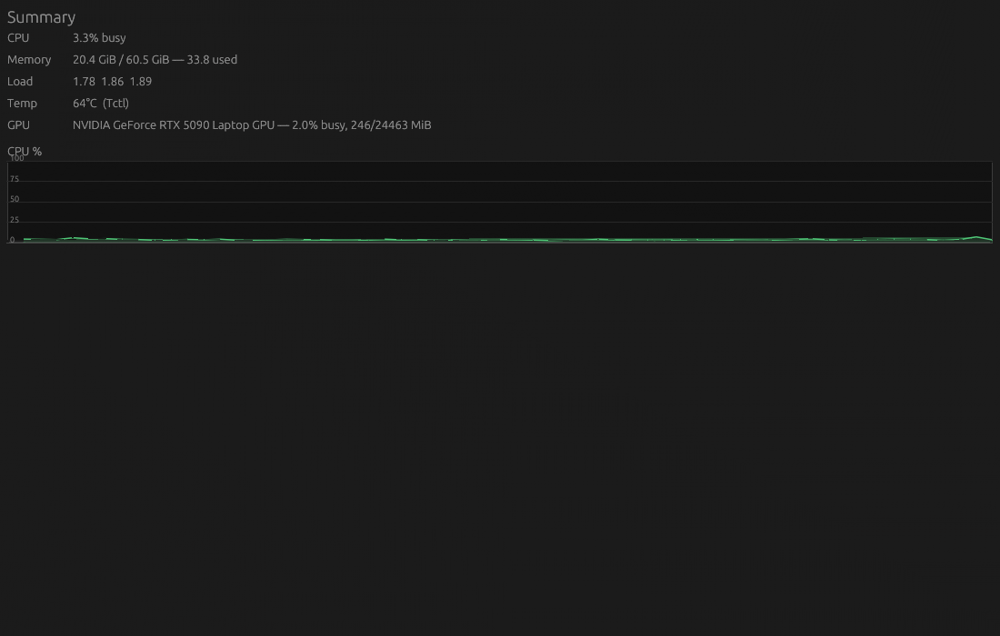

# rsTMOG

Task Manager OG, rewritten in Rust. Linux-only by design.

A from-scratch Rust reimplementation of the TMOG concept (Dave Plummer's
Task Manager OG), inspired by the behavioral design of
[evildojo-tmog](https://github.com/mikedesu/evildojo-tmog) (MIT, Michael
Bell). No C++ code is ported line-by-line; the Rust is written idiomatically.



## What you get

- **Eight pages**: Summary (live CPU/temperature trend graphs + readouts),
  CPU (aggregate history graph, per-core bars, topology + freq/governor),
  Memory (used% graph, ARC-aware stacked composition bar, PSI), Disks
  (per-device read/write rate graphs + identity), Network (per-iface
  rx/tx graphs, totals, speed/MAC), Thermals (CPU trend + grouped hwmon
  sensors), Processes (sortable/filterable table, tree view, follow mode,
  right-click End/Force-kill/Suspend/priority/Copy-cmdline), System.
- **ZFS ARC-aware memory accounting** (the btop view): reclaimable ARC
  folds back into available so a big ARC doesn't fake a full machine.
- **NVIDIA GPU** via NVML (dlopen'd — no build-time driver dependency).
- **Six themes** (dark + green/amber/blue phosphor + mono + light), live
  switching, persisted — with theme-aware window and tray icons.
- **System tray**: Open / poll-rate (500/1000/2000 ms) / Quit.
- **Settings dialog**: theme, poll rate, process-table defaults; saved to
  TOML immediately.
- **Headless mode**: `rstmog --capture <page> out.png` renders any page
  through the real egui pipeline with a software rasterizer — no GPU or
  window server needed. `--smoke` runs it across all pages as a CI gate.

## Layout

```
crates/tmog-core/   metrics library: /proc + /sys + NVML collectors,
                    pure parsers, fixture-tested, zero GUI deps
src/                rstmog bin: egui frontend (gui/, graph widget,
                    processes table), sampler (+ background thread),
                    tray/icons, headless capture, CLI
assets/icons/       app icons (dark/light, 16-1024 px + SVG)
packaging/          .desktop entry + installer for KDE/GNOME menus
docs/               headless-rendered page screenshots
```

## Download

Linux x86_64 AppImages are on the [release page](https://github.com/jcgit1/rsTMOG/releases). No Rust toolchain is required. Vulkan and the NVIDIA driver stay on your machine; the AppImage bundles GTK 3 for the tray.

```sh
chmod +x rstmog-*-x86_64.AppImage
./rstmog-*-x86_64.AppImage
```

Rebuild it with Docker (Ubuntu 22.04, so the binary still runs on older glibc):

```sh
bash packaging/appimage/build.sh
```

## Building

```sh
cargo build            # debug
cargo run              # GUI
cargo test --workspace # 100 tests, no root, no live-proc deps
bash scripts/ci.sh     # fmt + clippy + tests + self-test + smoke + deny
```

Requires Rust stable and (Linux) GTK 3 + libappindicator **only for the
system tray** — the app runs fine without a usable tray (degrades to no
tray). Desktop launcher:

```sh
cargo build --release
BINDIR=$PWD/target/release bash packaging/install-desktop.sh
```

## CLI

```
rstmog                     GUI
rstmog --self-test         live sanity pass over every collector
rstmog --snapshot          one-shot terminal dashboard
rstmog --capture <page> <out.png>   headless page render (no GPU/X)
rstmog --smoke             render every page headless; non-zero on failure
rstmog --version
```

## License

MIT — see [LICENSE](LICENSE). "Task Manager OG"/TMOG is Dave Plummer's
product; this project is not affiliated with or endorsed by him, and no
upstream code or assets are included.
